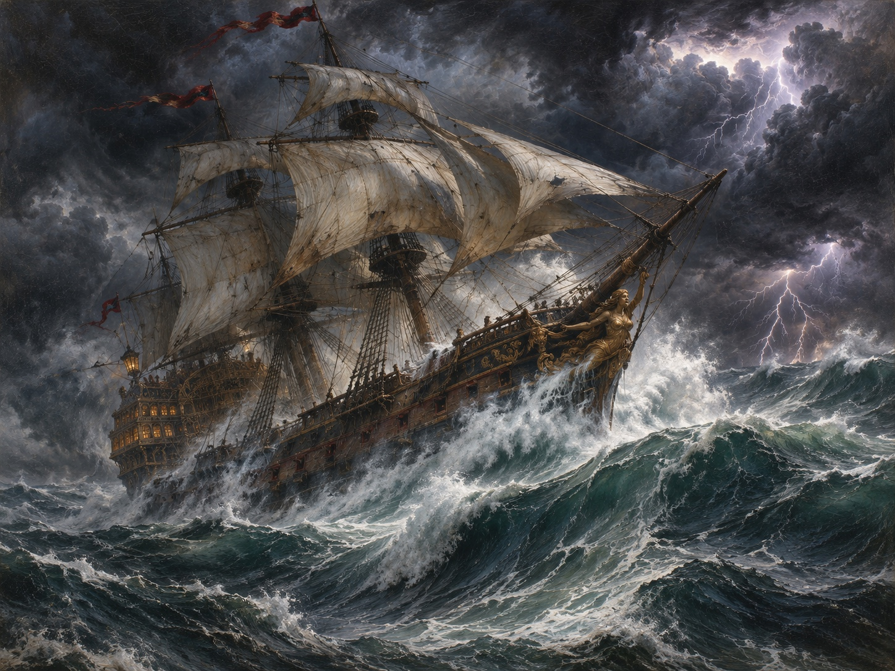

# IMPERIAL ART

**Recreating the Art of the Past. Creating the Masterpieces of the Future.**

IMPERIAL ART is an AI-powered creative platform within IMPERIAL Core, designed to study, understand, and recreate artistic techniques from different historical periods.

## How It Works

1. **Choose an Artist** — Select a legendary master such as Michelangelo, Leonardo da Vinci, Rembrandt, or another artist.
2. **Study the Style** — AI analyzes reference artworks, including brushwork, colors, lighting, composition, textures, and artistic techniques.
3. **Describe Your Vision** — Tell the AI what you want to see.
4. **Create a Masterpiece** — AI generates an original artwork based on the selected artistic style.
5. **Refine and Preserve** — Improve details, maintain visual consistency, and save your creations.

## Our Vision

To build an intelligent digital art studio where humanity’s artistic heritage meets the creative possibilities of artificial intelligence.

**One Artist. Infinite Possibilities.**

**Founder · Owner · CEO: Alexander Romaskevich**

**IMPERIAL Core 💎**

---

*Development status: product vision and repository presentation. AI-powered style analysis and artwork generation are planned features, not yet verified as implemented.*
